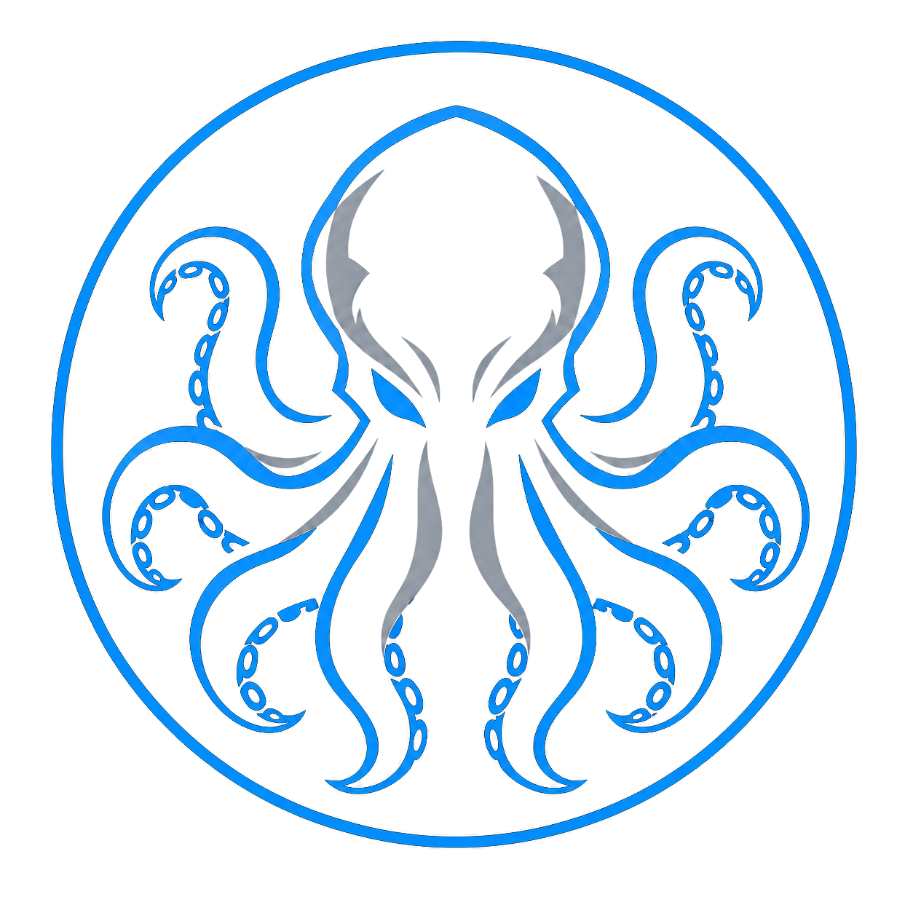
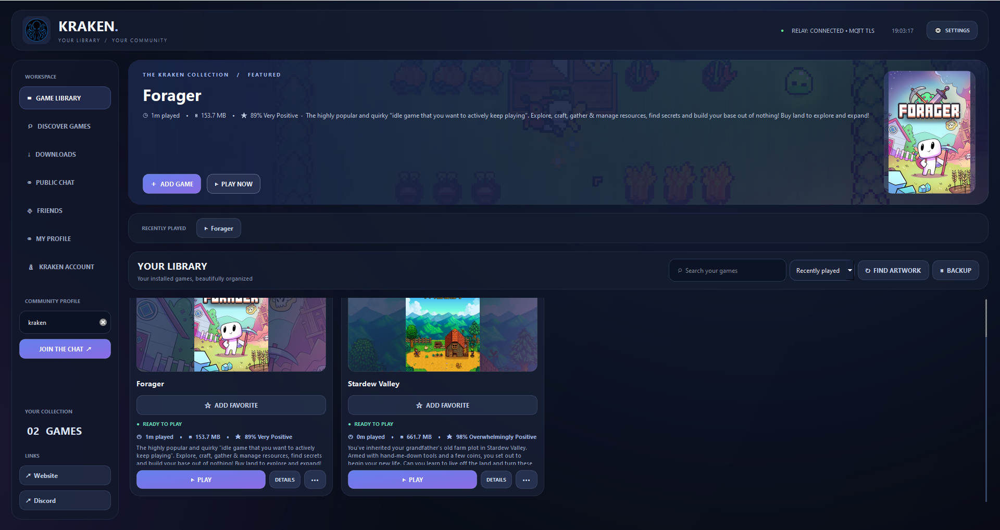
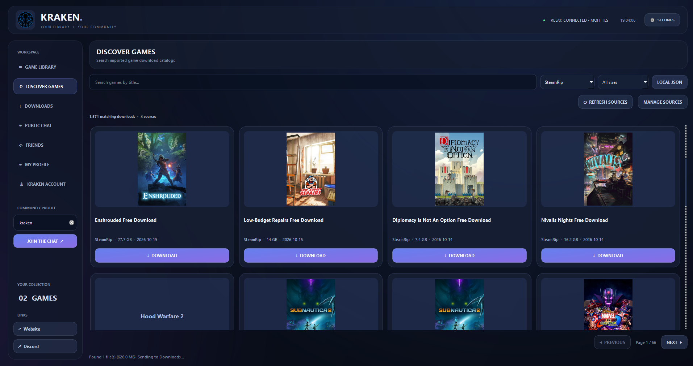
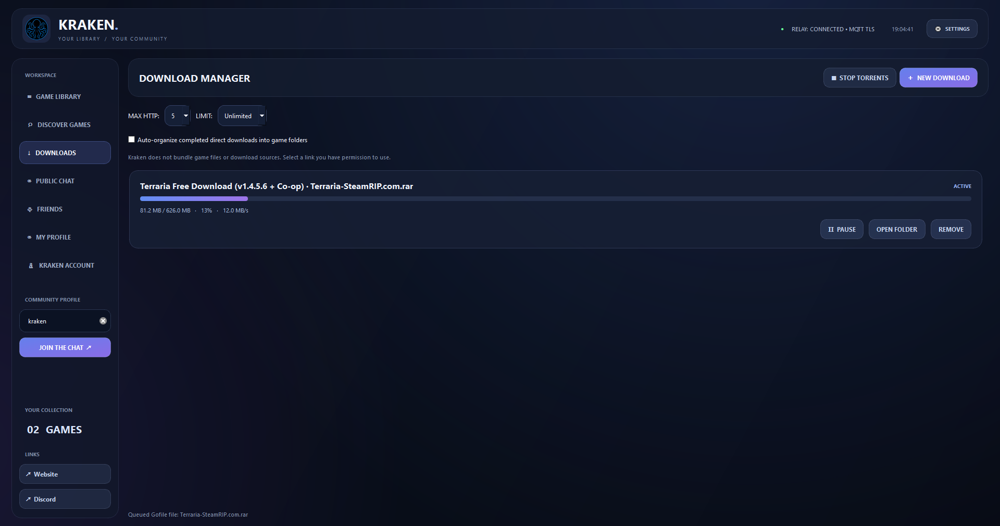
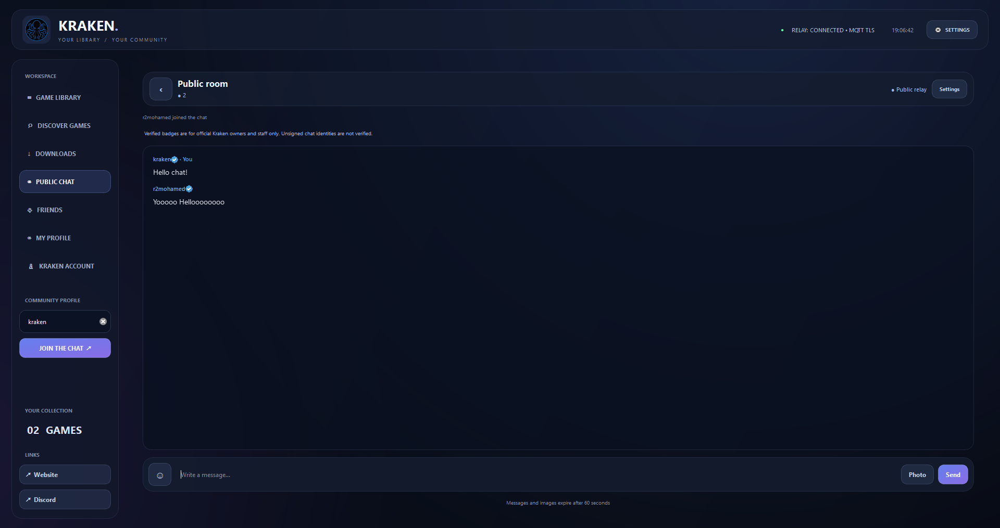
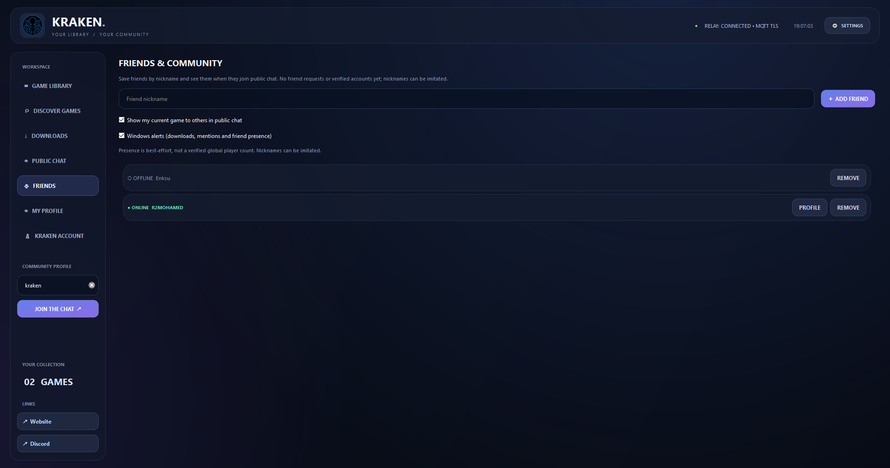
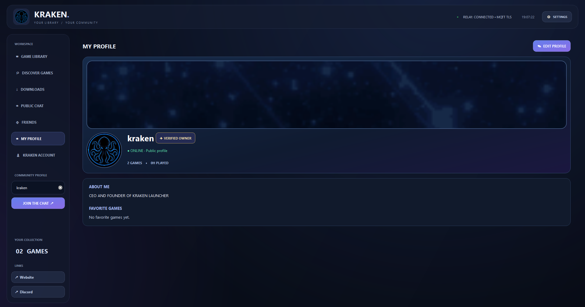

  

  # KRAKEN.

  **Your games. Your library. Your community.**

  Organize your games, manage downloads, and connect with other players—all in one place.

  [**⬇ Download for Windows**](https://github.com/KrakenPiracy/KrakenLauncher-Updates/releases)

---

## Features

**Game Library** · **Discover** · **Downloads** · **Public Chat** · **Friends** · **Player Profiles**

## A look inside Kraken

These are screenshots from the real Windows launcher. Click any image to view it at full resolution.

### Game Library

### Discover Games

### Download Manager

### Public Chat

### Friends

### Player Profiles

---

  ## Get Kraken Launcher

  **Windows 10 / 11 (64-bit)**

  [**Download the latest release**](https://github.com/KrakenPiracy/KrakenLauncher-Updates/releases)

  Download `KrakenLauncher.exe` from GitHub Releases. No Python installation required.

