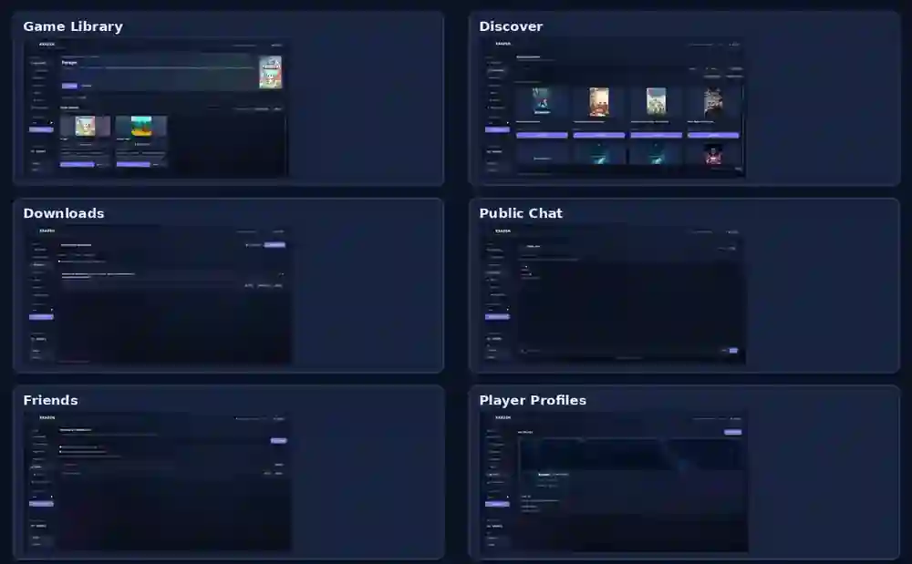

# KRAKEN.

### Your library. Your community.

**One place for your games, downloads, and friends.**

[**⬇ Download for Windows**](https://github.com/KrakenPiracy/KrakenLauncher-Updates/releases) · [View Releases](https://github.com/KrakenPiracy/KrakenLauncher-Updates/releases)

---

## Meet Kraken Launcher

Kraken is a modern Windows launcher that brings your game library and gaming community together in one clean, customizable experience.

- **Game Library** — Organize your installed games, find artwork, and launch them in one click.
- **Game Discovery** — Browse available catalogs and manage downloads.
- **Download Manager** — Track progress and manage your download queue.
- **Community Chat** — Talk with other players and share images.
- **Friends & Profiles** — Discover who’s online and personalize your gaming profile.
- **Updates** — Get notified when a new release is available.

## Screenshots

Game Library · Discover · Downloads · Public Chat · Friends · Profiles

## Download

**Windows 10 / 11 (64-bit)**

[**Download Kraken Launcher**](https://github.com/KrakenPiracy/KrakenLauncher-Updates/releases)

Open the latest release, download **`KrakenLauncher.exe`**, and launch it. No Python installation is required. Future updates are available from inside Kraken.

---

**KRAKEN.** — *Your games. Your space.*

